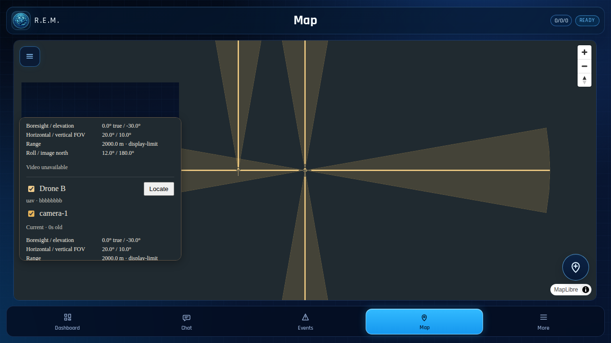
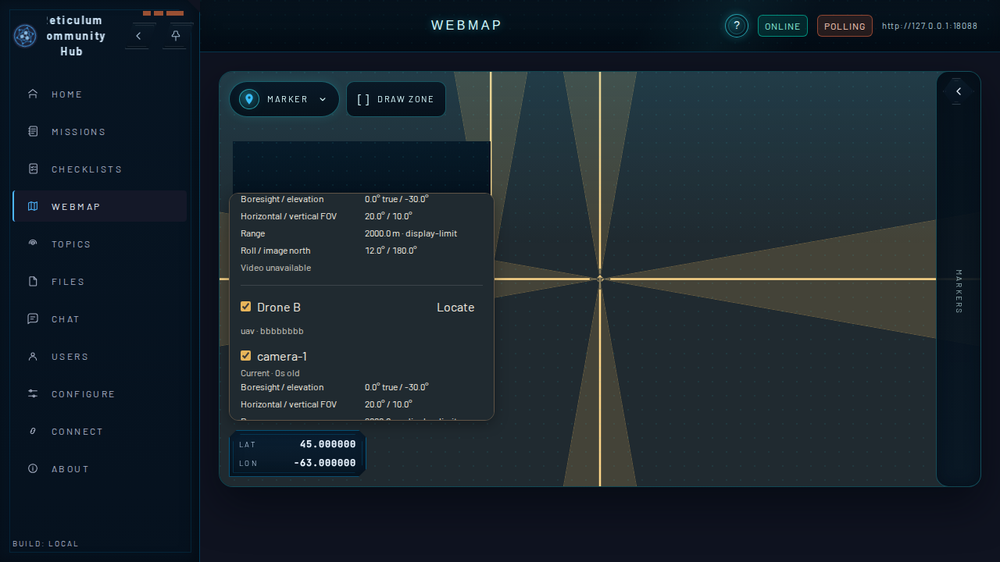

# R3S/1 implementation evidence

Software implementation: 31 October 2026. The protocol remains provisional and operational release is gated below. This record separates automated/synthetic evidence from physical qualification.

## Implemented layers

- Shared RCH `r3akt-map-core`: bounded SID 128 model/codec, nullable source fixes, independent object streams, optional-extension isolation, monotonic SQLite state/tombstones and native geodesic display projections.
- REM native: authenticated source/hub admission, signed plugin/component ownership and separate grants, current-policy checks at enqueue/retry/recovered custody, latest-state cadence, receipt-confirmed static metadata and operator-bound video approval.
- Plugin API 1.4 and existing JNI/UniFFI/Capacitor client: four operations, typed projections and a synthetic map fixture. Kotlin bindings were regenerated using the workspace UniFFI tool; generated outputs stay ignored.
- RCH: authenticated object receipt, complete collector snapshots, per-recipient metadata, current policy checks before daemon admission, native `/Sensors` projection/operator API, and the existing TAK connector's CoT sensor adapter.
- Both maps: native GeoJSON on the existing MapLibre instance, per-origin/component visibility, details, style reload, stale suppression and unavailable-service cleanup.

## Checks

| Check | Evidence |
|---|---|
| REM native suite | 531 tests passed against the final locked Git pin, including synthetic LXMF peers and new ownership/lifecycle/receipt/Connected-hub regressions |
| REM strict all-target Clippy | Passed with Rust 1.99.1; local LXMF emits an existing dependency dead-code warning |
| REM unit checks | 229 tests passed: source/class gate tests, app helpers, node-client boundary and dependency compatibility |
| REM frontend | Typecheck and web build passed; existing large-bundle warning remains |
| Source/class size | 729 first-party files passed; no raised limits or new exceptions |
| Android | SDK and map-fixture JVM unit tests, app Java compilation, and Android arm64 Rust check against the final locked Git pin passed |
| UniFFI | Kotlin regenerated; optional ktlint executable unavailable |
| REM map browser | Chromium passed: five native sensors, controller/drone origins, same map, origin hiding, style reset, stale state, service failure |
| RCH frontend | 210 unit tests, typecheck, lint and production build passed |
| RCH map browser | Default production suite (3 tests) and focused native-fixture/lifecycle suite (1 test) passed |
| RCH Rust | 746 workspace tests passed, two existing ignored tests; changed server/TAK owners reran with 449 passed and two ignored; strict all-target Clippy and unchanged module-size budget passed |
| Published shared revision CI | All 13 PR checks passed at `1eacf4c5a24a129722a5e7f46e83999b6eb1c407`, including both Rust workflows, release builds, ZMQ projection floor, source-size/format and browser suites |

The deterministic browser fixture is produced by RCH `cargo +1.99.1 run -p r3akt-map-core --features sqlite --example sensor_fixture`. Its JSON is checked into both browser suites. JavaScript does not construct coverage geometry.

## Acceptance coverage

| Specification | Software evidence and limit |
|---|---|
| T01–T03 | Documented CoT sample semantics, nullable/sentinel altitude, separate unapproved RTMP candidate, attribute/range boundaries, exact v1 codec, nil/duplicates/limits |
| T04–T05 | Existing ordinary telemetry/collector fixtures remain covered; unchanged SID 2 byte checks; optional malformed NaN/map/extension/deep values isolated; original bytes and restart tested. The pinned Sideband `Telemeter` class preserved SID 2 and dropped SID 128 on repacking in all five standard location fixtures; see the [source-level probe report](evidence/sideband-repacking.json) |
| T06–T07 | Independent drone identity never mutates controller observer; authenticated relay binding; four independent component states, partial update and deletion-survivor collector snapshots; rendered native fixture on both maps |
| T08–T10 | Source-monotonic/equal-time conflict handling, expiry/skew/stale/nadir suppression, north wrap/antimeridian, canonical movement/rename/deletion, permanent tombstones and restart |
| T11 | Plugin/signer/grant isolation, explicit descriptor approval/revocation, current snapshot/target checks, Connected hub queue admission, delayed receipt/reconnect regressions. RCH post-admission daemon retry revocation remains open |
| T12 | Not run: physical drone/camera app, second physical REM, BLE, TCP/LoRa routes, calibration and on-device permission acceptance |

## Review gates

PRE ownership/architecture review completed before implementation. Read-only POST reviewers identified and verified fixes for partial collector state, canonical marker lifecycle, CoT source-time ordering/metadata deduplication, stale map cleanup, hub routing, delivery confirmation and route-bound receipts. Final REM correctness, RCH maintainer and evidence-verifier gates report ready. Reviewers inspected implementation and recorded checks; execution of the builds stayed with the main agent.

## Reproducible integration

REM pins shared RCH commit `1eacf4c5a24a129722a5e7f46e83999b6eb1c407`, published on `corvo/r3s-telemetry` in [draft PR #292](https://github.com/FreeTAKTeam/Reticulum-Community-Hub/pull/292). The final CI repair only extracts unchanged helpers to respect source-size budgets and separates the existing production browser suite from the dev-only native-fixture suite. Shared map/profile/protocol source is identical to the first tested commit `56d56d02b02bf80b24c241aaacbd1ad00678bad5`.

The Cargo manifest and lockfile resolve the published Git revision without path overrides. Compared with the preserved pre-feature dependency baseline, only the three RCH Git sources changed; registry versions remain unchanged. Existing local LXMF path dependencies and their previously repaired 0.16.0 lock entries remain intact.

Reproduce the principal REM checks from the repository root with Rust 1.99.1:

```sh
cargo +1.99.1 test --locked --manifest-path crates/reticulum_mobile/Cargo.toml
cargo +1.99.1 clippy --locked --manifest-path crates/reticulum_mobile/Cargo.toml --all-targets -- -D warnings
npm run check:source-size
npm run test:unit
npm --workspace apps/mobile run typecheck
npm run web:build
npx playwright test e2e/sensor-geometry.spec.ts
```

The Sideband probe executed unmodified `sense.py` and `geo.py` from commit `ef572b58e88ff4e4326d51778336922a53b2a03f` in an isolated Python process with RNS 1.5.7. It added a valid R3S extension to each shared `sideband_pyxis.json` location vector, called `Telemeter.from_packed(...).packed()`, and asserted identical decoded SID 2 values and absent SID 128. The report records source and SID 2 hashes. This checks the real pinned class; it does not exercise the Sideband UI, service, collector routing or radio.

## Remaining release gates

1. SID 128 allocation/interoperability agreement remains provisional.
2. The RCH daemon broker cannot cancel or re-authorize an already admitted retry. The host rechecks before admission; immediate revocation afterward is not proven. An upstream capability is required before claiming full network revocation.
3. RCH has no separate per-radio coalescing worker. Measure high-rate input, payload size and actual LoRa/BLE cadence, and qualify REM's conservative cadence on hardware.
4. No physical Binder instrumentation, full release APK, physical ATAK, live video reachability, hardware, sustained-radio or iOS qualification was performed. CoT video candidates are not automatically shared or exported.

No release, deployment or operational promotion is implied by these software checks. The unrelated `.claude/launch.json`, offline-map plan and pre-feature dependency-baseline work were preserved.

## Rendered evidence

Synthetic native projections on blank basemaps (no live peer or geographic-data claim):




